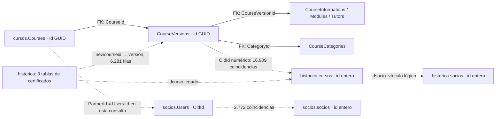

# Resultados de la consulta real

Fecha y evidencia: [corrida completa del 07/10/2026](README.md). Se consultaron tres destinos lógicos, cada uno con conexión y transacción propia. Los nombres físicos, host y usuarios quedan únicamente en el secreto local. `SHOW GRANTS` se inspeccionó en memoria: en las tres conexiones se verificaron permisos exclusivamente de lectura, sin permisos amplios ni delegación. MySQL respondió versión `8.0.46-0ubuntu0.22.04.4`; `@@session.transaction_read_only=1`. Todas las tablas relevantes son InnoDB. Las lecturas no constituyen una instantánea distribuida simultánea de los tres esquemas.

| Alias | Variable de base | Resultado actual | Alcance |
|---|---|---|---|
| socios | DB_CAMARA_SOCIOS | Conectado, cuenta y transacción de lectura | Identidad y copia de socios |
| cursos | DB_CAMARA_CURSOS | Conectado, cuenta y transacción de lectura | Cursos actuales y versiones |
| historica | CAMARA_DB_NAME | Conectado, cuenta y transacción de lectura | Cursos antiguos, socios y certificaciones |

En la configuración autorizada los tres destinos comparten host, pero son **bases distintas**; la cuenta de `CAMARA_DB_*` difiere de la de `USER_CAMARA`. TLS no estaba configurado en las sesiones: se reprodujo la configuración local heredada, sin intentar una degradación automática. No se afirma que el transporte esté cifrado.

## Socios e instituciones

| Métrica | socios.socios | historica.socios |
|---|---:|---:|
| Filas | 2.778 | 3.208 |
| Sin fecha_baja | 1.792 | 2.215 |
| Con fecha_alta | 2.778 | 3.208 |
| Con textoweb | 18 | 18 |
| Con textoweb y sin fecha_baja | 8 | 8 |
| Con web | 955 | 1.067 |
| Con Instagram | 2.294 | 2.661 |
| Con Facebook | 1.536 | 1.536 |
| Con YouTube / LinkedIn | 254 / 263 | 254 / 263 |
| Con mail_insti / whatsapp_insti | 2.778 / 2.778 | 3.208 / 3.208 |

Completitud significa no nulo/no vacío tras trim; no valida exactitud, vigencia, consentimiento ni entregabilidad del contacto. `textoweb` contiene HTML en los 18 casos. Entre los 1.792 sin baja de la copia `socios`, sólo 8 tienen presentación (0,45%). Hay ubicación casi completa, pero es ubicación de la institución, no necesariamente lugar de cursada. 425 webs de esa copia no empiezan por HTTPS; 276 valores de Instagram no cumplen la forma HTTPS esperada. Requieren validación, no un enlace construido ciegamente.

Todos los socios de ambas copias tienen `estado=1`, incluso los de `fecha_baja` informada: **estado=1 no distingue vigencia**. `fecha_alta` no prueba el año de fundación. La regla de negocio precisa de baja/reingreso sigue pendiente de confirmación con la Cámara.

Los 2.778 IDs de la copia `socios` existen en la histórica, pero ésta contiene otros 430. Hay 10 nombres y 9 fechas de baja diferentes entre IDs coincidentes. No se puede elegir la fuente maestra por el nombre de la base. No se mezclan campos entre copias silenciosamente. Nombres normalizados repetidos: 23 grupos/23 filas excedentes en la copia; 43/48 en histórica. No basta para fusionar instituciones.

## Cursos actuales y contenido

19.810 filas `Courses`, 19.569 con `Deleted=0`; 19.975 `CourseVersions`, 19.710 con `Deleted=0`. Para medir presentación se tomó **una última versión no eliminada por curso no eliminado**, ordenada por VersionNumber, CreatedAt e Id descendentes. Es una convención analítica; la versión publicable deberá elegirse expresamente. No se retrocede a una versión aprobada antigua para ocultar un borrador nuevo.

| Campo en las 19.569 últimas versiones | Disponibles | Ausentes o inválidos |
|---|---:|---:|
| CourseInformations / Title | 19.569 | 0 |
| TotalHours positivo | 19.563 | 2 nulos y 4 negativos |
| Objectives | 2.653 (13,56%) | 16.916 |
| DestinedTo | 2.605 (13,31%) | 16.964 |
| EvaluationMethod | 2.632 (13,45%) | 16.937 |
| Al menos un módulo | 2.561 (13,09%) | 17.008 |
| CategoryId informado | 19.150 | 419 |
| Al menos un tutor vinculado | 19.415 | 154 |
| RequestDate | 19.386 | 183 |

Hay 86 categorías actuales. No son las seis áreas ficticias del prototipo. Los títulos de categoría y sus frecuencias están en la evidencia; hace falta decidir si se presentan directamente o mediante una clasificación editorial con correspondencias explícitas.

Sí existe un campo de recurso visual para categorías: CourseCategories.IconUrl y los icono de categcur/cat históricos. Se verificó su estructura; no se descargaron recursos ni se midió su cobertura. No equivalen a logos institucionales, portadas o videos de cursos.

2.640 objetivos y los 2.605 destinatarios con contenido incluyen HTML. Hay 14.462 módulos no eliminados, todos con Title y Content; 14.008 contenidos incluyen HTML. Se deben convertir a texto seguro conservando párrafos/listas, o adoptar un sanitizador autorizado en backend. No usar HTML operativo sin revisión ni `dangerouslySetInnerHTML` para estos campos.

No hubo cursos sin versión, versiones huérfanas, informaciones sin versión, múltiples informaciones no eliminadas por versión ni números de versión duplicados por curso. El índice de CourseInformations.CourseVersionId **no es UNIQUE**, aunque hoy no se encontraron duplicados. Siete grupos repiten Order de módulo: ordenar por Order e Id y advertir la anomalía. TotalHours va de -120 a 5.200; los negativos se rechazan y los valores extremos requieren validación académica.

## Relaciones entre propietario, curso y versión

- `Courses.PartnerId` no tiene FK externa declarada. **Ninguno de los 19.569 cursos coincide con Users.Id** en el esquema socios disponible (2.429 PartnerId distintos). No se confirmó el directorio al que pertenecen esos GUIDs. No usar esta unión para autorizar a un socio.
- Users tiene 3.222 filas, 3.201 no eliminadas, 3.197 OldId informados y 3.172 numéricos. 2.772 enlazan con la copia socios; 425 OldId informados no enlazan. No hubo OldId duplicados entre usuarios no eliminados. Esto tampoco convierte a Users en el directorio de Courses.PartnerId.
- En 16.909 últimas versiones, OldId numérico enlaza exactamente con historica.cursos.id. Los 16.909 recuperan un `idsocio` existente en ambas copias de socios; 4.532 remiten a un socio con baja en la histórica. La relación parcial `PartnerId ↔ idsocio` no presenta ambigüedades en ese subconjunto. **2.660 cursos carecen de este puente legado**. No extrapolar la correspondencia al resto sin confirmación.
- No hay duplicados de OldId entre últimas versiones. La métrica `institution_mismatch=0` de la unión por Users tiene denominador de propietarios recuperados **cero**: no valida propiedad. Usar `legacy_owner_recovery` y `legacy_owner_ambiguity` para el subconjunto efectivamente recuperado.
- OldId se valida como cadena numérica antes de convertir a entero; se evita comparar cadenas con collations diferentes. Los GUID actuales usan ascii_general_ci; newcourseid histórico utf8mb3_spanish_ci. Las consultas convierten sólo GUIDs con formato válido, preservando el índice de destino.

## Estados: evidencia y límites semánticos

| Status actual | Approved | Active | Últimas versiones |
|---:|---:|---:|---:|
| 0 | 0 | 1 | 355 |
| 1 | 0 | 1 | 2 |
| 2 | 0 | 1 | 1 |
| 2 | 1 | 1 | 17.600 |
| 4 | 0 | 1 | 109 |
| 5 | 0 | 1 | 1 |
| 6 | 0 | 1 | 41 |
| 6 | 1 | 1 | 1.460 |

`Deleted` es un marcador de eliminación lógica separado. `Approved` y `Active` son booleanos operativos; **19.060** cumplen ambos, pero esto no autoriza publicación. Active=1 en todas las últimas versiones, incluso muchas con Status=6 y antecedente histórico inactivo. La comparación de migración encuentra 1.439 Status=6/Approved=1 relacionados con `inactivo=1` sin otras banderas, pero también 12 Status=2/Approved=1 asociados a inactivo=1. No hay equivalencia automática. El enum oficial Status, sus transiciones, el alcance de Approved y el efecto de Active requieren código/confirmación del sistema emisor.

342 últimas versiones tienen ExpirationDate nula; ninguna fecha informada estaba vencida respecto a UTC en la corrida. Esta observación no resuelve el significado de Status=6. RequestDate, fecha_solicitud y ExpirationDate son fechas administrativas; no son comienzo/fin de cursada.

`CourseInformations.Format`: códigos 1 (18.020), 2 (937), 3 (411), 4 (201). **No se confirmó su significado**; el portal conserva modalidad null hasta contar con un mapeo oficial. `historica.cursos.tipocurso` tiene 1 (12.857) y 2 (4.184); no se equipara a Format ni a modalidad.

En los 17.041 cursos históricos conviven `estado`, `inactivo`, `observado` y `desaprobado`. Hay combinaciones con estado=1 e inactivo/desaprobado=1. Los nombres de banderas orientan a estados administrativos, pero sus reglas precisas siguen pendientes. Cuatro cursos no enlazan con socio, 82 no enlazan con categcur y uno tiene horas no positivas. 544 grupos repiten socio+título normalizado (619 filas excedentes); no son necesariamente duplicados de negocio.

## Certificaciones y catálogos antiguos

| Tabla histórica | Filas | estado=1 con fecha_validacion | Sin curso legado | newcourseid → CourseVersions.Id |
|---|---:|---:|---:|---:|
| certificados | 111.288 | 110.122 | 4.652 | 4.607 de 4.607 |
| certifidise | 945 | 924 | 36 | 40 de 40 |
| certifisemi | 30.900 | 30.758 | 1.626 | 1.634 de 1.634 |

Son **143.133 registros** de certificación; no personas únicas ni certificados actualmente válidos. En las tres tablas, todas las filas estado=1 tienen fecha_validacion y ninguna estado=0 la tiene. Eso respalda una interpretación de validación administrativa, pero no confirma emisión efectiva, revocaciones, alcance ni futuras ofertas. No se inspeccionaron datos de titulares.

Los 6.281 newcourseid informados enlazan con **CourseVersions.Id**, y **cero** con Courses.Id. Para el curso estable seguir `CourseVersions.CourseId`; no reinterpretar el identificador. Los registros sin curso legado pueden tener el puente moderno: no sumarlos como huérfanos definitivos ni sumar ambos enlaces duplicando un certificado. Falta aprobar la precedencia en conflictos entre idcurso y newcourseid.

Un certificado no tiene socio histórico; seis de certifidise tienen idsocio distinto al curso legado enlazado. Hay 897 IDs compartidos entre certificados y certifidise. Identidad interna de una certificación: `(alias de fuente, tabla, id)`, nunca id aislado. Las tres tablas no tienen FKs declaradas a cursos/socios.

`categcur` contiene 84 filas y `cat` 32. Coinciden 32 IDs, con 9 nombres diferentes; cat.id es double y no PK. No unir las taxonomías por igualdad numérica. `CourseCategories` es otro espacio de GUIDs, con 86 filas activas. Las categorías de socios/cuotas tampoco son áreas académicas.

`Courses.CertifyingInstitutionId` tiene 2.607 valores distintos y ninguno enlaza con Users.Id ni es PartnerId. En 16.963 últimas informaciones coincide con `CertifyingEntityId`; faltan identificar su directorio y semántica. No demuestra que el emisor sea la Cámara. `socios.CertificateHolders` describe titulares personales; no es una tabla de acreditaciones públicas de institutos.

## Qué no se encontró y qué queda por acordar

En las tablas relevantes no se identificaron campos dedicados para precio de oferta, semanas/calendario, sede de cursada, logo institucional, portada/video de curso, resultados de aprendizaje, habilidades, requisitos, proyecto práctico, reseñas verificadas, sello progresivo ni autorización de publicación en Mercado Cámara. Esto describe el alcance consultado: no prueba ausencia en sistemas externos o almacenamiento de archivos.

`Categories.MonthlyFee`, `categorias.valorcuota` y `datos.valorcert` son conceptos distintos al precio del curso: no se reutilizan. `FormationLevels` participa en formación de tutores: no es dificultad del curso ni nivel del sello. `programa` y `cv` históricos son varchar(7), no un programa curricular extenso; su semántica y los archivos asociados no se confirmaron.

Prioridades de integración: confirmar directorio de PartnerId y cuenta autenticada; decidir copia maestra de socios y bajas; obtener enums oficiales; verificar emisor y elegibilidad de certificado; definir publicación independiente y versión expuesta; completar contenidos/medios/precios; acordar dónde persistir campos nuevos. Ninguno se resolvió mediante una escritura o migración en esta auditoría.
